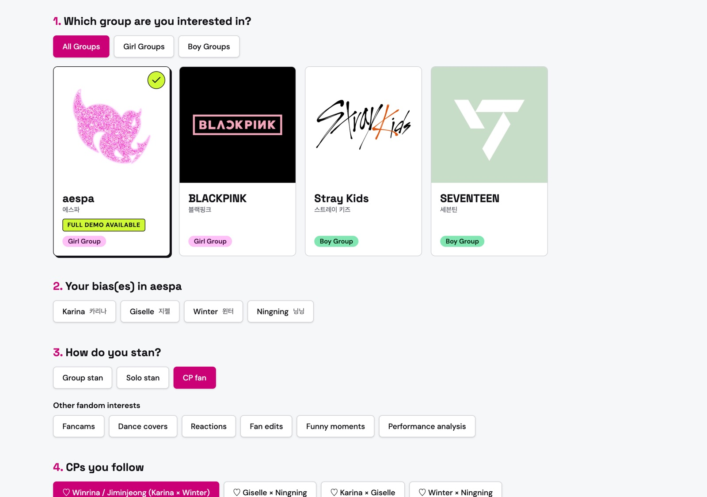
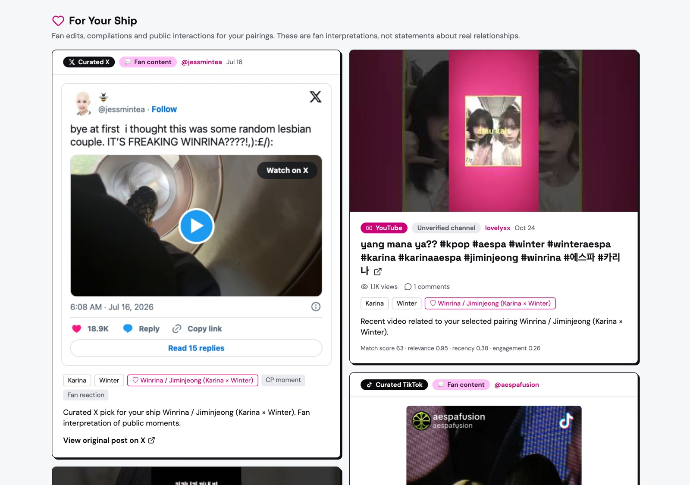
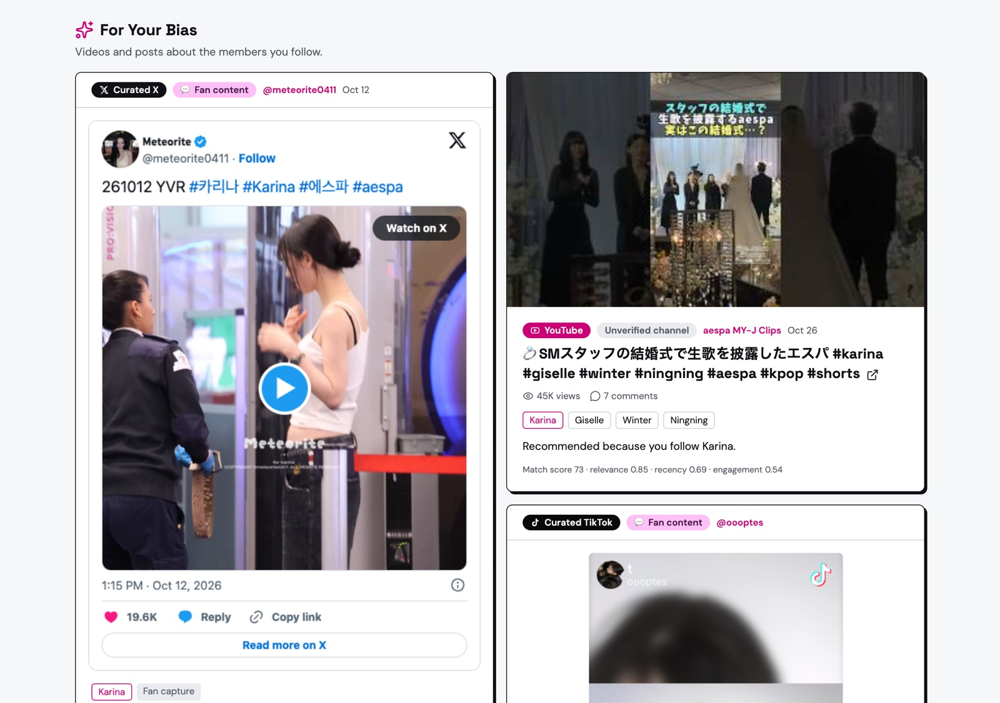
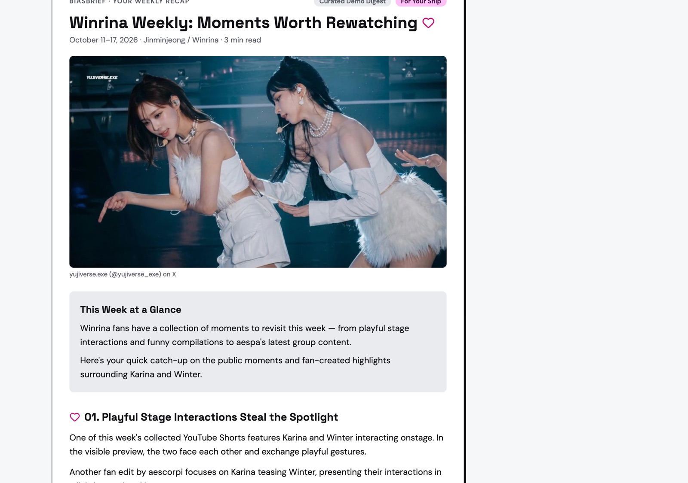
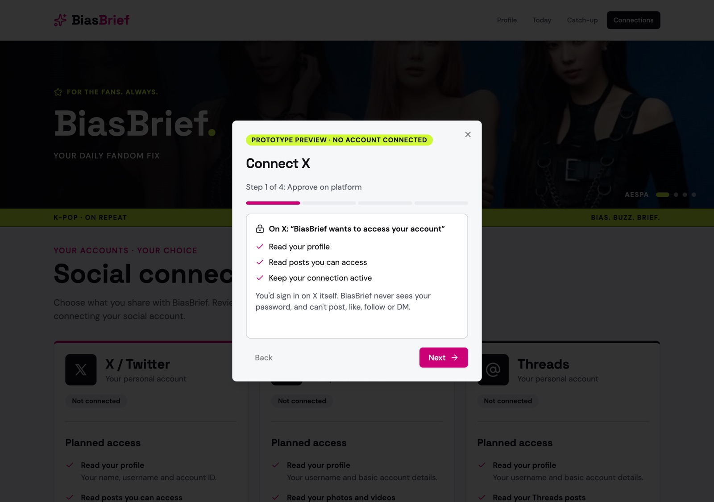
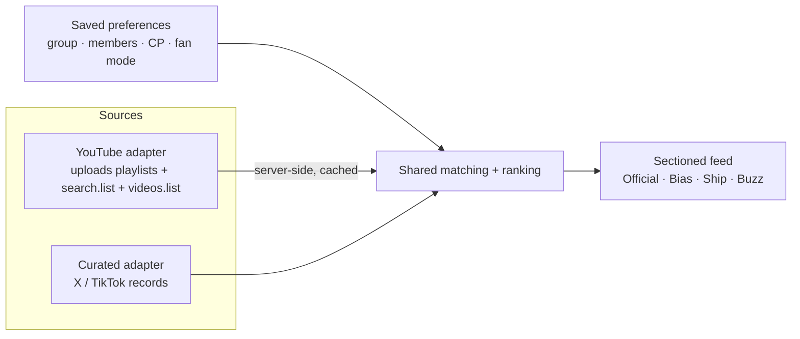

# BiasBrief ✦ Personalized K-pop Fandom Digest

> Stay in your fandom without living on your feed.
> 不用一直刷时间线，也能跟上你的饭圈。

BiasBrief is a working prototype of a personalized K-pop fandom feed. Fans pick a group, their bias, their ship and how they stan. The app then pulls together official updates, fan content and a weekly recap from YouTube, X and TikTok, with every item labeled by source and nothing invented.

**English** · [中文简介](#中文简介)



## What it does

| | |
|---|---|
| **Fandom onboarding** | Four groups (aespa, BLACKPINK, Stray Kids, SEVENTEEN) with girl/boy filters, real member lists, group / solo / CP fan modes, and named or custom pairings. aespa is the full-demo group. |
| **Personalized feed** | Official Updates, For Your Bias, For Your Ship and Fandom Buzz sections. Each item lands in one section, chosen by your fan mode. |
| **Live YouTube data** | Uploads from hand-verified official channels, plus member / CP / buzz searches with real view and comment counts. You can switch between 7-day and 14-day windows. |
| **Cross-platform** | 20 hand-picked X posts and TikTok videos shown through each platform's official embeds, with All / YouTube / X / TikTok filters. |
| **Weekly recap** | Catch-up mode shows a persona-specific newsletter (Karina solo stan or Winrina CP fan). |
| **Connections** | A step-by-step preview of the future X / Instagram / Threads authorization flow, clearly labeled as a preview. |

<table>
<tr>
<td width="50%"><br><sub><b>CP fan:</b> curated X / TikTok next to live YouTube results</sub></td>
<td width="50%"><br><sub><b>Solo stan:</b> the same data, a different feed</sub></td>
</tr>
<tr>
<td><br><sub><b>Catch-up:</b> weekly recap for Winrina fans</sub></td>
<td><br><sub><b>Connections:</b> authorization flow preview</sub></td>
</tr>
</table>

More screens: [platform filter](docs/screenshots/05-feed-platform-filter.jpg) · [Karina recap](docs/screenshots/07-catchup-karina.jpg) · [rotating hero](docs/screenshots/02-hero.jpg) · [mobile](docs/screenshots/09-mobile-feed.jpg)

## How it works



- **One data model, swappable sources.** YouTube and curated X/TikTok items go through the same matching rules (members, pairings, fan mode) and render as the same kind of feed entry. A real X or TikTok API adapter could replace the curated one without changing the UI.
- **Transparent ranking.** Score = relevance 50% + recency 20% + log-scaled views/comments *per day* 30%, so one viral video can't take over the feed. Each YouTube card shows its score breakdown and a plain-language reason ("Recommended because you follow Karina").
- **Honest by design.** Official channel IDs were verified by hand. Agency uploads count only when the title names the group. Fan content and CP content are labeled as fan interpretation. When a request fails or the quota runs out, the app falls back to cached results with a notice, and never makes up content. Curated posts are labeled "Curated X / TikTok", not "live".
- **Quota-aware.** The API key stays server-side. Each channel, search query and video is cached once and shared by every user who picks the same group, member or CP. Stats requests are batched 50 videos at a time.

**Stack:** TanStack Start (React 19, SSR + server functions) · TypeScript · Tailwind CSS + shadcn/ui · YouTube Data API v3 · X & TikTok official embeds · Vitest (26 tests) · Bun

## Run locally

```bash
bun install
echo "GOOGLE_API_KEY=<your YouTube Data API v3 key>" > .env.local
bun --bun vite dev   # → http://localhost:8080
```

On macOS you can also double-click `start-demo.command`. The demo walkthrough is in [docs/DEMO.md](docs/DEMO.md).

```bash
bun run test        # unit tests: matching, ranking, dedupe, quota fallback, curated dataset
```

## Prototype scope

| Feature | Status |
|---|---|
| YouTube feed | ✅ Live API |
| X / TikTok posts | 🟡 20 hand-picked real posts, official embeds; not a live API |
| Weekly recap | 🟡 Two prewritten demo digests, not generated at runtime |
| Account connections | 🟡 Flow preview only. Real OAuth needs X's paid API tier and Meta / TikTok app review |
| Full personalization | aespa. Other groups get official uploads + group buzz |

## Team

<!-- Add names, roles and links -->
| Name | Role |
|---|---|
| | Product / research |
| | Design |
| | Engineering |

---

## 中文简介

BiasBrief 是一个**个性化 K-pop 饭圈资讯**原型：用户选好团体、本命、CP 和粉丝类型后，App 会把 YouTube、X、TikTok 上的官方动态、粉丝内容和每周回顾整理成一份专属资讯。每条内容都标明来源，绝不编造。

**核心功能**
- **饭圈引导**：4 个团体，可按男团/女团筛选；有真实成员名单；支持团粉、唯粉、CP 粉三种模式和 CP 选择。aespa 为完整演示团体。
- **个性化 Feed**：分为 Official Updates / For Your Bias / For Your Ship / Fandom Buzz 四个区块，按粉丝类型决定每条内容放进哪个区块，同一条内容只出现一次。
- **YouTube 实时数据**：来自人工核实过的官方频道，加上成员、CP 和饭圈话题搜索；显示真实播放量和评论数；可切换 7 天 / 14 天。
- **跨平台**：20 条人工精选的 X / TikTok 内容，用官方嵌入展示；支持按平台筛选。
- **每周回顾**：Catch-up 页面按粉丝身份显示不同的周报（Karina 唯粉 / Winrina CP 粉）。
- **账号连接**：X / Instagram / Threads 授权流程的分步预览，明确标注为预览。

**技术亮点**
- **统一数据模型 + 可替换的数据源适配器**：将来接入 X / TikTok 官方 API 时，前端不用改。
- **可解释的排序**：相关度 50% + 时效 20% + 对数归一化的日均互动 30%，避免一个爆款视频霸占整个 feed。
- **API 失败时回退到缓存，绝不用编造内容填充**；API key 只在服务端使用；缓存在用户之间共享，节省配额。

**原型边界**：X / TikTok 内容是人工精选的，周报是预写好的，账号连接只是流程预览；完整个性化目前只支持 aespa。

## Notes

- Group photos, embedded posts and video thumbnails belong to their respective owners and are used here only for a non-commercial student prototype.
- Originally scaffolded with [Lovable](https://lovable.dev), then extended with Claude Code.
