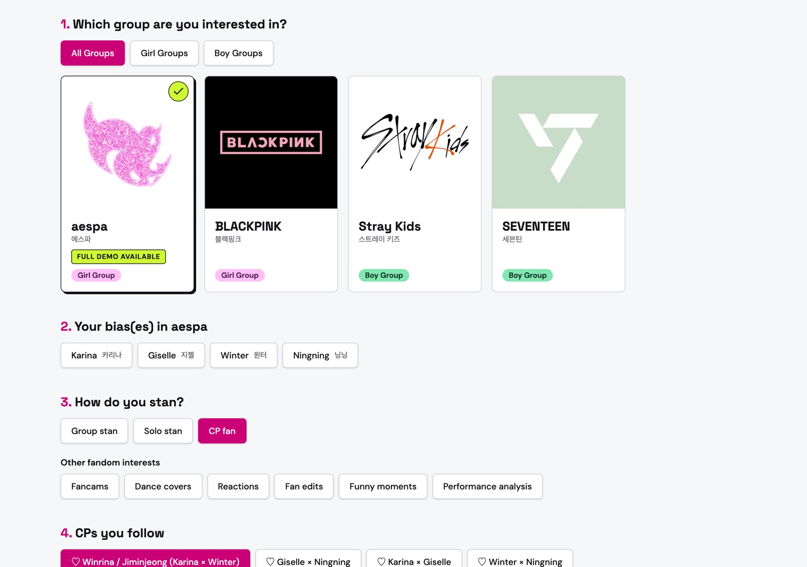
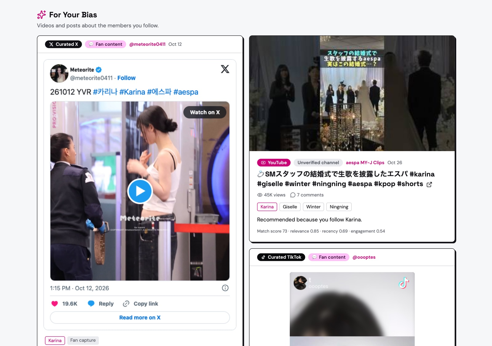
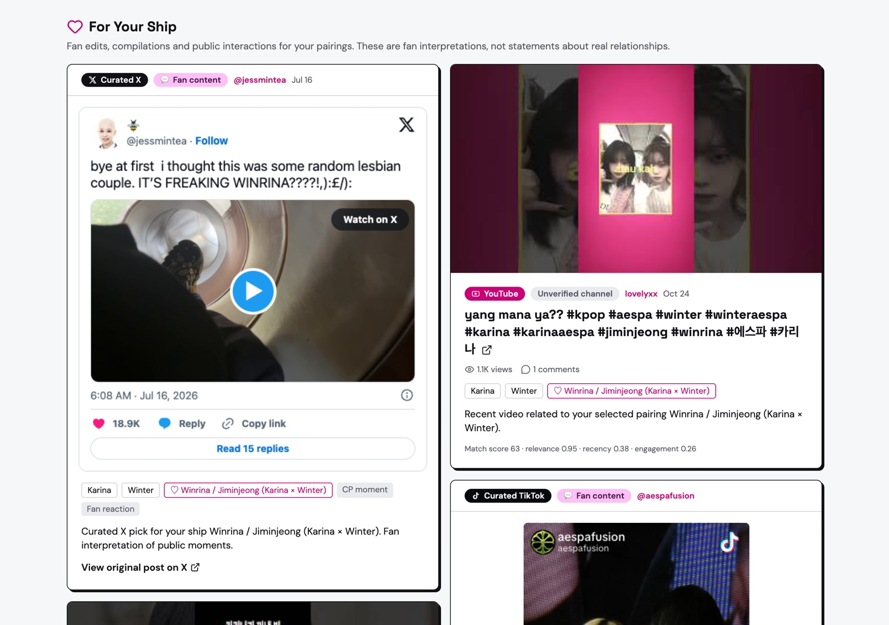
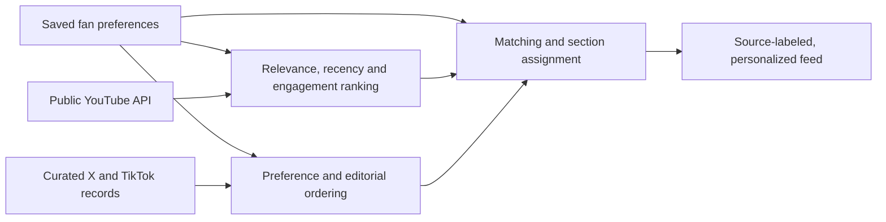

# BiasBrief

**Personalized K-pop content discovery, organized around fan preferences.**

[中文 README](README.zh-CN.md) · [Demo walkthrough](docs/DEMO.md)

BiasBrief brings official updates and fan-created content into a single, preference-based feed. Fans select a group, favorite members, pairings, and interests to discover content that matches how they follow their fandom.

The product addresses a focused opportunity: reducing the effort of finding relevant updates across multiple platforms. It combines audience segmentation, source-aware content organization, and explainable recommendation rules in an interactive web application.



## Core features

| Feature | Experience |
| --- | --- |
| **Preference-based onboarding** | Choose from aespa, BLACKPINK, Stray Kids, and SEVENTEEN, then select members, interests, and a group, solo, or pairing-focused fan mode. |
| **Personalized content sections** | Explore Official Updates, For Your Bias, For Your Ship, and Fandom Buzz. Each item is assigned to one section according to its matches and the selected fan mode. |
| **YouTube discovery** | Browse uploads from verified official channels and public search results, with source labels, engagement counts, recommendation reasons, and 7-day or 14-day YouTube windows. |
| **Cross-platform browsing** | View curated X and TikTok posts alongside YouTube videos, or filter the feed by platform. Each card links to its original source. |
| **Catch-up recaps** | Read edited highlights for the Karina solo and Winrina pairing profiles. Other profiles can continue directly to their personalized feed. |
| **Connection permission preview** | Review proposed social-account permissions through a separate Connections page before any future account integration. |

<table>
<tr>
<td width="50%"><br><sub>Member-focused discovery</sub></td>
<td width="50%"><br><sub>Pairing-focused discovery</sub></td>
</tr>
</table>

## Product and analytical approach

**Audience preferences shape the experience.** Group, solo, and pairing-focused modes translate different content needs into matching and section-priority rules. These are explicit preference segments, making the logic easy to inspect and explain.

**Ranking balances relevance, freshness, and engagement.** YouTube videos receive a score based on relevance to selected preferences (50%), recency (20%), and log-scaled average daily views, likes, and comments (30%). Cards expose the score components and a recommendation reason. The score is a rule-based prioritization measure, not a prediction of future engagement.

**Content retains its source context.** Official uploads, fan-created videos, and curated posts are labeled separately. Curated X and TikTok items are ordered by preference matches and editorial priority, then interleaved with YouTube results. This preserves different source characteristics rather than treating unlike platform metrics as interchangeable.

**Data handling supports reliable browsing.** Member aliases and canonical pairing identities support matching; video IDs support deduplication. Server-side caching, batched statistics requests, and cached-result fallback reduce repeated retrieval and preserve available content when requests fail.

Together, these choices demonstrate how a product problem can be translated into audience segments, content data structures, prioritization rules, and user-facing explanations.

## How it works



YouTube data is fetched server-side. Curated records share the feed's display structure while retaining their own metadata and ordering. Preferences are saved in the browser.

## Get started

Requirements: [Bun](https://bun.sh/) and a YouTube Data API v3 key for the YouTube feed.

```bash
git clone https://github.com/jiatongy-svg/biasbrief.git
cd biasbrief
bun install
```

Create `.env.local` in the project root and add:

```dotenv
GOOGLE_API_KEY=your_youtube_data_api_key
```

Keep this file out of version control. Start the app:

```bash
bun --bun vite dev
```

Open **[http://localhost:8080](http://localhost:8080)**. On macOS, `start-demo.command` also provides a double-click launcher after Bun is installed at the path expected by the script.

For a short demonstration, follow the [Karina solo and Winrina pairing scenarios](docs/DEMO.md).

## Technology and validation

TanStack Start · React · TypeScript · Tailwind CSS · shadcn/ui · YouTube Data API v3 · Vitest

```bash
bun run test
bun run build
```

The test suite covers preference storage, pairing identities, query planning, content matching, ranking, deduplication, API failure handling, and recap navigation. Live content and third-party embeds should also be checked in the intended presentation environment.

## Data and integration notes

The curated collection contains 20 X and TikTok posts. aespa has member- and pairing-level discovery; the other three groups provide official uploads and group-level discovery. Recaps are edited content, and the Connections page presents a permission flow without authorizing accounts.

YouTube ranking uses metadata, not video transcripts or comment-text analysis. Average engagement per day does not measure actual growth over time. See the [roadmap](roadmap.md) for future integration and evaluation work.

## Contributors and attribution

[@jiatongy-svg](https://github.com/jiatongy-svg) · [@HazelYang0105](https://github.com/HazelYang0105) · [@ruiyiqian](https://github.com/ruiyiqian)

Group images, thumbnails, and embedded posts belong to their respective owners. This repository does not grant reuse rights over third-party media.
