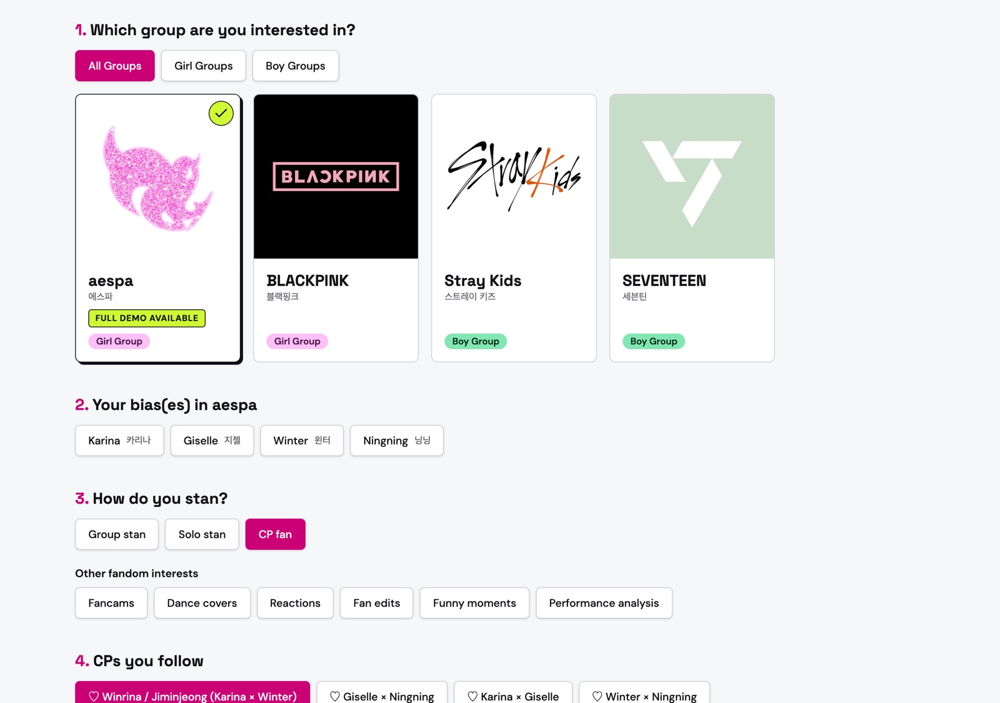

# BiasBrief

**围绕粉丝偏好组织内容的个性化 K-pop 资讯应用。**

[English README](README.md) · [演示指南（英文）](docs/DEMO.md)

BiasBrief 将官方动态与粉丝创作内容整理到同一条个性化资讯流中。用户选择团体、关注成员、组合及兴趣后，可以按自己的追星偏好发现内容，并跳转到原始来源。

项目关注跨平台查找与筛选信息的使用场景，将用户偏好分群、多来源内容组织和可解释推荐规则结合为可交互的 Web 应用。



## 核心功能

| 功能 | 使用体验 |
| --- | --- |
| **偏好设置** | 支持 aespa、BLACKPINK、Stray Kids、SEVENTEEN，可选择成员、兴趣，以及团粉、唯粉或 CP 粉模式。 |
| **个性化资讯流** | 内容分为 Official Updates、For Your Bias、For Your Ship 和 Fandom Buzz；根据匹配结果与用户模式分配到一个版块。 |
| **YouTube 内容发现** | 整合已核实官方频道的上传与公开搜索结果，展示来源、互动计数、推荐理由和分数组成；支持 7／14 天的 YouTube 时间窗口。 |
| **跨平台浏览** | 将精选 X、TikTok 内容与 YouTube 视频共同展示，支持平台筛选和原帖跳转。 |
| **Catch-up 回顾** | 为 Karina 唯粉与 Winrina CP 粉提供已编辑的内容回顾，其他偏好可以直接进入对应资讯流。 |
| **连接权限预览** | 在独立 Connections 页面查看未来账号接入所需的权限说明。 |

## 产品与分析方法

**用显式偏好组织用户需求。** 团粉、唯粉与 CP 粉模式对应不同的内容匹配和版块优先级，使个性化逻辑清晰、可解释。

**平衡相关度、时效与互动信号。** YouTube 评分由偏好相关度 50%、时效 20% 和对数缩放的日均播放、点赞及评论信号 30% 构成。卡片显示分数与推荐理由，帮助理解内容为何出现。

**保留不同来源的特点。** 官方内容、粉丝视频与精选帖子分别标记。X／TikTok 内容按偏好匹配和编辑优先级排序，再与 YouTube 结果交替展示。

**提高数据处理与浏览的可靠性。** 成员别名和统一组合身份用于匹配，视频 ID 用于去重；服务端缓存、批量统计请求及缓存回退支持内容获取。

该项目展示了从产品问题出发，建立用户偏好分类、内容数据结构、优先级规则和解释性呈现的过程。

## 本地运行

需要 Bun；YouTube 资讯流需要 YouTube Data API v3 Key。

```bash
git clone https://github.com/jiatongy-svg/biasbrief.git
cd biasbrief
bun install
```

在项目根目录创建 `.env.local`：

```dotenv
GOOGLE_API_KEY=your_youtube_data_api_key
```

不要将该文件提交到 Git。启动：

```bash
bun --bun vite dev
```

打开 **[http://localhost:8080](http://localhost:8080)**。macOS 用户也可在满足启动脚本要求后双击 `start-demo.command`。

## 技术与验证

TanStack Start · React · TypeScript · Tailwind CSS · shadcn/ui · YouTube Data API v3 · Vitest

```bash
bun run test
bun run build
```

测试覆盖偏好存储、组合身份、查询规划、匹配、排序、去重、请求失败处理和回顾页面导航。实际内容和第三方嵌入效果应在展示环境中核对。

## 数据说明

精选内容共 20 条 X／TikTok 帖子。aespa 支持成员与组合级发现，其他三个团体支持官方上传和团体级内容发现。回顾为已编辑内容；Connections 页面不执行账号授权。

YouTube 排序使用元数据，不分析视频正文或评论文本；日均互动指标也不等同于实际增长率。后续方向见[路线图（英文）](roadmap.md)。

## 贡献者与来源

[@jiatongy-svg](https://github.com/jiatongy-svg) · [@HazelYang0105](https://github.com/HazelYang0105) · [@ruiyiqian](https://github.com/ruiyiqian)

团体图片、缩略图及嵌入内容归其权利人所有，本仓库不授予第三方媒体内容的再使用权。
